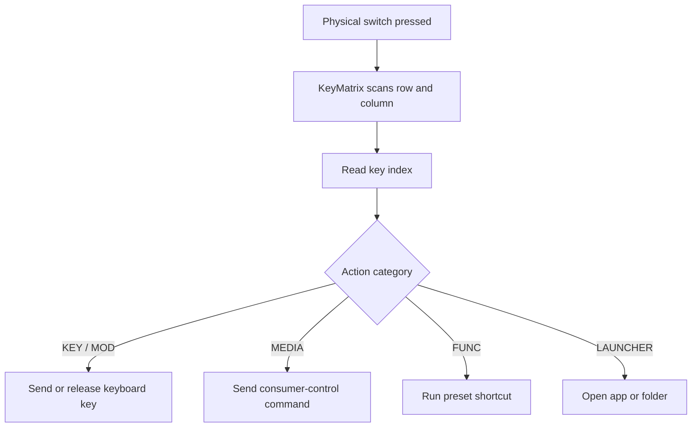

<div align="center">

# ⚡ Modular Pico Macropad

**A custom 5×4 USB macro keyboard built around a removable Raspberry Pi Pico H — with editable CircuitPython firmware and a browser-based configurator.**

[](https://www.raspberrypi.com/products/raspberry-pi-pico/)
[](https://circuitpython.org/)
[](https://www.usb.org/hid)
[](#-current-keymap)

*Physical modularity. Editable firmware. Your shortcuts, your layout.*

</div>

---

## ✨ Overview

This project is a **custom-built, PCB-based 20-key macropad** arranged in a 5-row × 4-column switch matrix. A removable **Raspberry Pi Pico H** runs CircuitPython and presents the device to a computer as a USB HID keyboard/media controller.

It is designed to be adaptable rather than locked to one set of shortcuts. The firmware's matrix pin configuration and key mapping can be edited, while a companion web configurator provides a visual way to change key assignments and generate a new `code.py`.

The PCB also includes a **1×04 female expansion connector** for a plug-in daughterboard. The planned daughterboard has three switches arranged in one column. Its hardware connection is designed, but its firmware integration is **not configured yet**; that will be completed after the daughterboard is soldered and tested.

## 🧩 Highlights

- **20-key matrix** — five rows and four columns, scanned using CircuitPython's `keypad.KeyMatrix`.
- **Removable controller** — the Pico H can be detached from the main PCB.
- **USB HID controls** — standard keyboard keys, held modifiers, media controls, and shortcut macros.
- **App and folder launching** — launch an app through Windows Search or open a path through the Run dialog.
- **Visual key configurator** — select a key in the on-screen matrix and edit its action.
- **Firmware generation** — preview the generated Python and download it as `code.py`.
- **Browser-assisted saving** — in a supported browser, choose the mounted Pico drive's directory and write the generated `code.py` there.
- **Expansion-ready PCB** — a 1×04 connector is provided for a future three-switch daughterboard.
- **Reusable firmware structure** — matrix pins and key assignments are clearly separated so the code can be adapted to another compatible macropad using the same controller.

## 🖥️ Web configurator

The companion configurator is a standalone HTML page using **HTML, CSS, and JavaScript**. It shows a clickable 5×4 key grid, a key configuration panel, and a live preview of the generated firmware.

### Supported action types

| Type | What it does | Examples |
|---|---|---|
| `KEY` | Sends a standard key press/release | Escape, Home, Insert, Delete, Space |
| `MOD` | Holds a modifier while the switch is held | Alt, Ctrl, Windows |
| `MEDIA` | Sends a consumer-control command on press | Volume, brightness, play/pause, mute |
| `FUNC` | Runs a predefined shortcut function | Screenshot, display mode, Action Center, lock |
| `LAUNCHER` | Opens an app or folder/path | Spotify, a folder path |

### Using the configurator

1. Open the configurator HTML file in a modern browser.
2. Select a key in the 5×4 matrix.
3. Choose an action category and assign the desired key, media command, macro, or launcher target.
4. Review the generated firmware preview.
5. Choose **Download `code.py`** to save the file manually, or use **Connect & Save to Pico** to select the Pico's mounted drive folder and write the file.

> **Browser note:** The direct-save option uses the browser's File System Access API (`showDirectoryPicker`). Use a compatible browser such as a recent Chromium-based browser and grant access to the selected folder. It writes the file you select; it does not flash firmware or communicate with the Pico over a custom serial protocol. If direct saving is unavailable, download `code.py` and copy it to the Pico drive manually.

## 🔌 Hardware

### Main macropad

| Component | Role |
|---|---|
| Raspberry Pi Pico H | Removable microcontroller running CircuitPython |
| 20 switches | Main 5×4 input matrix |
| 1N4148 diodes | Matrix diode isolation, as shown in the schematic |
| Custom PCB | Switch matrix, controller connections, and expansion connector |
| 1×04 female connector | Interface for the planned daughterboard |
| USBLC6-2SC6 | Protection component shown on the expansion signal lines in the schematic |
| 4.7 kΩ resistors | Pull-up resistors shown for the expansion signal lines |

### Matrix pin assignment

The current firmware uses the following GPIO mapping:

| Signal | Pico GPIO |
|---|---|
| Row 0 | `GP0` |
| Row 1 | `GP1` |
| Row 2 | `GP2` |
| Row 3 | `GP3` |
| Row 4 | `GP4` |
| Column 0 | `GP5` |
| Column 1 | `GP6` |
| Column 2 | `GP7` |
| Column 3 | `GP8` |

The matrix is initialized with `columns_to_anodes=True`, matching the diode orientation configured in the current firmware and schematic.

### Expansion connector

The main PCB has a 1×04 female connector for a matching 1×04 male connector on the daughterboard. The planned add-on contains **three switches in one column** and is intended to be plug-in modular.

**Status:** the connector and daughterboard concept are in place, but the three extra switches have not yet been added to the firmware. The pin assignments and scanning logic for the expansion board should be confirmed against the assembled hardware before use.

## 🧠 Firmware

The current firmware lives in `code.py` on the Pico and uses:

- `board` for GPIO pin definitions
- `keypad` for matrix scanning and switch events
- `usb_hid` for USB HID device access
- `adafruit_hid.keyboard` and `keycode` for keyboard input
- `adafruit_hid.consumer_control` for media and consumer controls
- `adafruit_hid.keyboard_layout_us` for typing launcher targets

### How a key press is handled



The key index is mapped to an action in `KEY_MAPPING`. For a different matrix that uses the same controller, update `ROW_PINS`, `COL_PINS`, and the key mapping to match your PCB.

### Current keymap

The table below describes the mapping in the supplied `code.py`. You can modify it to your liking.

| Index | Current action |
|---:|---|
| 0 | Escape |
| 1 | Screenshot — `Win + Shift + S` |
| 2 | Home |
| 3 | Alt modifier |
| 4 | Insert |
| 5 | Launch Spotify |
| 6 | Page Down |
| 7 | Display mode — `Win + P` |
| 8 | Brightness down |
| 9 | Brightness up |
| 10 | Play / Pause |
| 11 | Action Center — `Win + A` |
| 12 | Open `C:\Program Files (x86)` |
| 13 | Volume down |
| 14 | Volume up |
| 15 | Ctrl modifier |
| 16 | Windows modifier |
| 17 | Delete |
| 18 | Lock PC — `Win + L` |
| 19 | Space |

> **Windows-specific behavior:** the preset shortcuts and launcher workflow are written for Windows. Standard HID keys and supported media commands may work on other operating systems, but the exact shortcut behavior depends on the host OS.

## 🚀 Setup

### 1. Prepare the Pico

1. Install a compatible version of [CircuitPython](https://circuitpython.org/board/raspberry_pi_pico/), if it is not already installed.
2. Connect the Pico to your computer and confirm that its CircuitPython drive appears.
3. Ensure the `adafruit_hid` library is available in the Pico's `lib` directory. Use a library bundle compatible with your CircuitPython version.

### 2. Install the firmware

1. You can copy the `code.py` file and `configurator_app.py` file from the repository to your PICO. 
2. Either visit https://aryankpoor.github.io/macropad or Press the top left key on your macropad thrice in quick succession. 
3. This will run a script which will automatically open up configurator_app.py stored on the PICO which you can use to fully modify the macropad. It is the same as the website but just the local version.
4. Finally, press the macropad switches and verify the expected keyboard/media actions.
5. You can change the 3-successive key press macro from top left key to any other key of your choice. Just change the key number in ```if key_idx == 0:``` from 0 to the one you want.

### 3. Configure keys in the browser


## 📁 Repository layout

The project consists of these main parts:

```text
macropad/
├── code.py                 # CircuitPython firmware installed on the Pico
├── index.html              # Browser-based key mapping and code generator
└── README.md               # Project documentation
└── configurator_app.py     # Local Macropad Configuration tool
```


## 🛠️ Technology stack

- **Hardware:** Raspberry Pi Pico H, custom PCB, switches, diodes, expansion connector
- **Firmware:** CircuitPython, Python
- **USB input:** USB HID
- **HID libraries:** Adafruit CircuitPython HID
- **Configurator:** HTML, CSS, JavaScript

## 🗺️ Roadmap

- [x] Design and order the main 5×4 macropad PCB
- [x] Implement the main matrix firmware in CircuitPython
- [x] Add keyboard, modifier, media, macro, and launcher actions
- [x] Build a browser-based configurator and Python code preview
- [x] Add a connector for a modular daughterboard
- [ ] Solder and test the three-switch daughterboard
- [ ] Integrate the daughterboard's switch inputs into the firmware and configurator
- [ ] Validate the expansion connector's pinout and behavior on assembled hardware

## ⚠️ Notes

- Always verify generated `code.py` before installing it; the configurator and firmware defaults are not identical in every assignment.
- The configurator's launcher actions type targets using a US keyboard layout and invoke Windows shortcuts, so host layout and OS behavior can affect results.
- The expansion board is a planned extension, not a currently configured feature.
---
